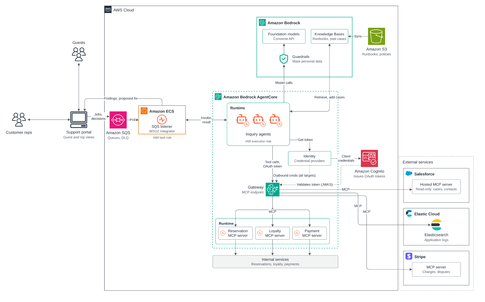

# Customer Inquiry Agent on AWS

## Description

A customer support agent for a hotel and resort group, deployed on AWS. It investigates guest
inquiries such as "why does my confirmation show the old dates?", proposes one fix with a draft
reply, and makes the change only after a support representative approves it. This is the sample
code for the AWS blog post "Build grounded customer support agents with Amazon Bedrock and
Choreo Integrator".

1. A representative sends an **investigation job** from a support portal.
2. An **inquiry listener** on Amazon ECS picks up the job and calls the **inquiry agent** on
   Amazon Bedrock AgentCore Runtime. The agent looks up the reservation, loyalty and payment
   records with **read-only tools**, and searches runbooks, policies and past cases in a
   **knowledge base**.
3. It returns **findings**, **one proposed fix** and a **draft reply**. An Amazon Bedrock
   guardrail masks personal data in its output.
4. The representative **approves or rejects**. Only an approved fix is applied, exactly as
   stored, and only once.
5. The resolved case is added to the knowledge base, so similar inquiries are faster next time.



- **Support portal:** a small Choreo Integrator service you run on your machine. It stands in
  for a support team's ticket system. Each case is an item in an Amazon DynamoDB table.
- **Inquiry listener:** a Choreo Integrator service on AWS Fargate. It reads the jobs and
  decisions queues (Amazon SQS), owns the case status, and calls the agent. Five investigations
  and two decisions can run at once.
- **Inquiry agent:** a Choreo Integrator AI agent on AgentCore Runtime. It uses Amazon Bedrock
  for the model, guardrail and managed knowledge base, and reaches its tools through
  AgentCore Gateway with tokens from AgentCore Identity. It holds no secrets.
- **Tools:** reservation, loyalty and payment MCP servers, also built with Choreo Integrator and
  hosted on AgentCore Runtime, with synthetic data. Investigations use only the read-only tools;
  write tools run only after approval.

All data is synthetic. The figure also shows Salesforce, Elastic and Stripe as examples of
targets a team could add to the gateway; they are not part of this sample. See
[docs/architecture.md](docs/architecture.md) for the flows, statuses and messages, and
[docs/security.md](docs/security.md) for the security notes.

## Project structure

| Path | Contents |
| --- | --- |
| [`support-portal/`](support-portal/) | Support portal you run locally: a web page and REST API to create cases, review findings, and approve or reject |
| [`inquiry-listener/`](inquiry-listener/) | SQS listener for Amazon ECS: owns the case status and calls the agent |
| [`inquiry-agent/`](inquiry-agent/) | Inquiry agent for AgentCore Runtime: the investigate and apply actions |
| [`mcp-servers/`](mcp-servers/) | Reservation, loyalty and payment MCP servers for AgentCore Runtime, with synthetic data |
| [`data/`](data/) | Runbooks, policies, seed resolved cases and the three sample inquiries |
| [`infra/`](infra/) | CloudFormation templates and request templates for the knowledge base and AgentCore |
| [`scripts/`](scripts/) | Deploy steps, portal configuration, demo and clean-up |
| [`docs/`](docs/) | Architecture and security notes |

The six packages form one workspace (`Ballerina.toml`), so you can open this folder in Choreo
Integrator and build or test them together with `bal build` and `bal test`.

## Prerequisites

- An AWS account and a Region where Amazon Bedrock AgentCore and managed knowledge bases are
  available. The defaults use `us-east-1`.
- Access to Claude Sonnet 5.5 in Amazon Bedrock through the US cross-Region inference profile
  (`us.anthropic.claude-sonnet-5-5`). To use another model, set `MODEL_ID` in `scripts/env.sh`.
- Permissions to create the resources listed in [`infra/README.md`](infra/README.md), including
  IAM roles, a VPC and an ECS cluster. [`infra/iam/`](infra/iam/) has least-privilege policies
  for the deploying user.
- AWS CLI v2 (tested with 2.39), Docker with Buildx and ARM64 support, `jq`, `curl` and Git.
- [Choreo Integrator](https://wso2.com/integrator/) 5.0.0 or later (Ballerina 2201.14.0).
- AWS credentials for the support portal, which runs on your machine. They need
  `dynamodb:GetItem`, `PutItem`, `UpdateItem` and `Scan` on the case table, `sqs:SendMessage` on
  the jobs and decisions queues, and `sqs:ReceiveMessage` on the two dead-letter queues.

## Deploy

1. Copy the settings file and edit it. Set your own `PROJECT_NAME` and a unique Cognito domain
   prefix.

   ```bash
   cp scripts/env.example.sh scripts/env.sh
   ```

2. Run the deploy script. It runs steps 01 to 05, then writes the support portal's `Config.toml`.
   Each step can also run on its own, and saves what it creates to `.deploy/outputs.env`.

   ```bash
   ./scripts/deploy.sh
   ```

   | Step | Script | Creates |
   | --- | --- | --- |
   | 1 | `01-foundation.sh` | SQS queues and DLQs, DynamoDB case table, S3 bucket, Cognito clients |
   | 2 | `02-knowledge-base.sh` | Guardrail, managed knowledge base, its two data sources and their content |
   | 3 | `03-mcp-servers.sh` | The three MCP server runtimes, and the gateway with its targets |
   | 4 | `04-agent.sh` | The agent's two credential providers and the inquiry agent runtime |
   | 5 | `05-listener.sh` | The listener on ECS |
   | | `portal-config.sh` | `support-portal/Config.toml`, from the deploy outputs |

   If a step fails with an unknown command or parameter, update the AWS CLI.

To follow the listener while it works, use the `PROJECT_NAME` from `scripts/env.sh`:

```bash
aws logs tail /ecs/<PROJECT_NAME>/inquiry-listener --follow
```

## Usage Instructions

1. Run the support portal. It uses your default AWS credentials and the `Config.toml` that
   `deploy.sh` wrote.

   ```bash
   cd support-portal
   bal run
   ```

2. Open http://localhost:9090 and enter your name in **Representative**. The listener passes it
   to the agent as the runtime user ID.

3. Choose one of the three sample inquiries, or type a guest's message. The case moves from
   **Queued** to **Investigating** to **Awaiting approval** in a minute or two. Select it to see
   the summary, root cause, evidence, proposed change and draft reply.

   | Sample inquiry | Expected proposal |
   | --- | --- |
   | "I changed my booking dates in the app, but my confirmation still shows the old dates." | `reservation___reissueConfirmation` for `R-48213`: the confirmation job for the date change failed |
   | "I stayed last weekend, but my loyalty points never showed up." | `loyalty___creditPoints`, 3,465 points for stay `S-90551`: the accrual ran before checkout and failed |
   | "There's a charge on my card from the resort that I don't recognize." | `payment___refundCharge` for `CH-7003`, 250.00: a check-in hold captured by mistake |

4. Choose **Approve**. The case moves to **Applying** and then **Applied**, and the **Write tool
   response** shows the change, such as the points adjustment for `S-90551`. Check the result on
   the case: each MCP server keeps its data in memory, so reading the records again may not show
   the change.

To create all three cases at once and wait for their investigations, run
`./scripts/06-demo.sh` while the portal is running. The portal also has a REST API:

```bash
curl -s -X POST localhost:9090/cases -H 'content-type: application/json' -d '{"sample": 2, "representative": "rep-ana"}'
curl -s localhost:9090/cases/<caseId> | jq '{status, findings, proposedAction, draftReply}'
curl -s -X POST localhost:9090/cases/<caseId>/decision -H 'content-type: application/json' -d '{"decision": "approve", "representative": "rep-ana"}'
```

Messages that ended up in a dead-letter queue are listed on the page, and at
`GET /failures`.

## Observability

The agent's spans go to Amazon CloudWatch, where **GenAI Observability > Bedrock AgentCore**
shows each investigation and apply with its model and tool calls. An OpenTelemetry Collector in
the agent's image signs the spans and sends them to the CloudWatch traces endpoint. Turn on
CloudWatch Transaction Search once per account and Region first. The spans carry the prompts
and tool results, so limit who can read the `aws/spans` log group. See
[`inquiry-agent/README.md`](inquiry-agent/README.md#tracing).

## Clean up

To avoid ongoing charges, delete everything the deploy scripts created:

```bash
./scripts/cleanup.sh
```

It lists what it will delete and asks you to type your `PROJECT_NAME` first. If a resource
cannot be deleted, the script says so and keeps it in `.deploy/outputs.env`, so you can run it
again.

## Before you use this in production

This sample shows a pattern with synthetic data. It was deployed and run end to end in
us-east-1 with Ballerina 2201.14.0 and AWS CLI 2.39. Before you adapt it:

- **Authenticate representatives.** The support portal has no sign-in. A real support system
  would authenticate representatives and decide who may approve which change.
- **Use private networking and your own keys.** Run the listener in private subnets with VPC
  endpoints, use VPC network mode for the AgentCore runtimes, and use customer managed AWS KMS
  keys.
- **Authorize tools at the gateway.** The agent's tool lists and its two Cognito clients keep
  investigations read-only. Add per-tool scope checks at AgentCore Gateway as a second line.
- **Plan for long investigations.** Each agent call must finish within 15 minutes, the limit
  for a synchronous AgentCore Runtime request. Longer work needs a streaming response.
